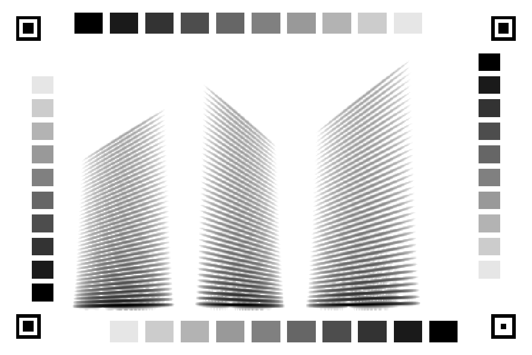

# Voxgram Card Format

**Format version:** `0.3-pilot`. Provisional until the first pilot validates it.

This is the shared specification that the encoder and the decoder must agree
on. The numeric values here are mirrored in
[`src/voxgram/format.py`](../src/voxgram/format.py); code imports them from
there and never repeats them as literals. To change the format, follow the
rule in [GIT_CONVENTION.md](GIT_CONVENTION.md#format-changes).

## 1. Audio

| Parameter | Value |
| --- | --- |
| Channels | Mono |
| Sample rate | 16,000 Hz |
| Duration | 3.0 s, which is 48,000 samples |
| Short recordings | Padded to 3.0 s |
| Silent recordings | Rejected by the encoder |

Handling of recordings longer than 3.0 s is not yet specified.

## 2. STFT

| Parameter | Value |
| --- | --- |
| FFT size | 512 |
| Window | Hann |
| Hop length | 128 |
| Centering | `center=True` |
| Padding mode | Constant |

Resulting magnitude grid:

- Frequency bins: 512 / 2 + 1 = **257**, linear from 0 to 8,000 Hz
- Frames: 1 + floor(48,000 / 128) = **376**

Reconstruction must use exactly the same STFT settings.

## 3. Image orientation

| Axis | Convention |
| --- | --- |
| Horizontal | Time, left to right. Column 0 is the first frame. |
| Vertical | Frequency, low frequency at the bottom. The top image row is bin 256. |
| Pixel value | 8-bit grayscale. 0 is black, 255 is white. |

## 4. Intensity encoding

Let `A` be the STFT magnitude divided by its maximum over the whole recording,
so `A` lies in [0, 1].

```
D = max(20 * log10(A), -60)          amplitude in dB, in [-60, 0]
q = round(-255 * D / 60)             stored grayscale, in [0, 255]
```

Darker means larger magnitude: the peak (`D = 0`) prints black (`q = 0`), and
everything at or below -60 dB prints white (`q = 255`).

## 5. Intensity decoding

Let `p` be the recovered grayscale value in [0, 255] after geometric and
photometric correction.

```
D_hat = -60 * p / 255
A_hat = (10 ** (D_hat / 20) - 0.001) / (1 - 0.001)
```

`A_hat` is a normalized linear magnitude in [0, 1]. Black decodes to 1 and
white decodes to 0.

`D_hat` is the exact inverse of the encoding and is the scale on which
extraction accuracy is measured. `A_hat` is what Griffin-Lim receives. The
floor amplitude 0.001 (-60 dB) is subtracted so that white means silence.
Without the subtraction every white cell carries -60 dB of energy; with about
two thirds of a speech spectrogram white, Griffin-Lim renders that as a
broadband hiss, measured at about 13 dB above the recording's own level in
quiet passages. The subtraction is continuous, so paper white that lands a
few levels below 255 after calibration still decodes to almost nothing, which
a hard "255 means zero" rule would not do.

What is lost:

- **Phase.** Estimated by Griffin-Lim.
- **Absolute level.** The magnitude is peak-normalized before encoding.
- **Values below -60 dB.** Printed white and decoded as silence.
- **Precision.** One gray level is 60 / 255, about 0.235 dB.

## 6. Physical layout

| Item | Value |
| --- | --- |
| Card size | 150 x 100 mm, landscape |
| Spectrogram region | 110 x 75 mm, centred |
| Paper | Matte white |
| Print resolution | Target 600 dpi if available |

Derived cell size: 110 mm / 376 frames and 75 mm / 257 bins both come to about
0.29 mm per cell, which is about 7 printer dots at 600 dpi.

Print at actual size, with any "fit to page" option off. To check the print,
measure between the centres of the two top markers: it must be 134 mm.

Record the actual printer, paper, print settings and phone settings with every
capture.

## 7. Canonical coordinates

**Status: draft, proposed in issue #3.** The values below are implemented in
`format.py`, `card.py` draws them, and they stay open to change until the team
agrees. Changing a value means changing a constant; the renderer and the
synthetic test cards follow.



### 7.1 Coordinate system

- Unit: millimetres.
- Origin: the top-left corner of the card. `x` runs right, `y` runs down.
- Points are written `(x, y)`.
- The data region has no axes, labels or decoration, and no border line.

### 7.2 Fiducial markers

Four markers, each made of three concentric squares:

| Part | Side | Colour |
| --- | --- | --- |
| Frame | 7 mm outside, 5 mm inside (1 mm thick) | Black |
| Gap | 5 mm outside, core inside | White |
| Core | 3 mm; **1.5 mm on the orientation marker** | Black |

Marker centres, in the order used for homography correspondences:

| Index | Position | Centre (x, y) | Kind |
| --- | --- | --- | --- |
| 0 | Top-left | (8, 8) | Finder |
| 1 | Top-right | (142, 8) | Finder |
| 2 | Bottom-right | (142, 92) | Orientation |
| 3 | Bottom-left | (8, 92) | Finder |

The order is clockwise as seen on the card. The centres form a 134 x 84 mm
rectangle. Each marker has at least 3.5 mm of white around it.

**Why this shape.** After thresholding and connected-component labelling, a
marker is two dark components, a frame and a core, whose centroids coincide.
Nothing else on the card has that property: patches are single solid
components and spectrogram blobs are irregular. Coinciding centroids and the
ratio of the two areas do not depend on how the card is rotated in the
photograph, which the bounding-box fill ratio does.

| Kind | Frame area | Core area | Frame : core |
| --- | --- | --- | --- |
| Finder | 24 mm² | 9 mm² | 2.67 |
| Orientation | 24 mm² | 2.25 mm² | 10.67 |

**Orientation cue.** The orientation marker is the one whose ratio is about
four times larger. It is the bottom-right corner. The finder farthest from it
is top-left. Of the remaining two, top-right is the one for which top-left,
top-right, bottom-right turn clockwise in image coordinates. This resolves
any rotation of the card, including upside down.

### 7.3 Calibration patches

Forty-four patches: the same 11 gray levels on each of the four sides.

Levels: `0, 26, 51, 77, 102, 128, 153, 179, 204, 230, 255`. Level 0 is solid
black. Level 255 is unprinted paper, kept as a defined place to sample white.

| Side | Patch size (w x h) | Pitch | First patch, top-left corner | Runs dark to light |
| --- | --- | --- | --- | --- |
| Top | 8 x 6 mm | 10 mm in x | (21, 3.5) | Left to right |
| Right | 6 x 5 mm | 6.5 mm in y | (135, 15) | Top to bottom |
| Bottom | 8 x 6 mm | 10 mm in x | (121, 90.5) | Right to left |
| Left | 6 x 5 mm | 6.5 mm in y | (9, 80) | Bottom to top |

The ramps run clockwise, so every level appears on all four sides and a black
patch sits near every corner. Opposite sides run in opposite directions, so a
brightness gradient across the card cannot be mistaken for the tone curve.
White paper between and around the patches gives white references all the way
round the data region.

`CALIBRATION_PATCHES` in `format.py` lists every patch as
`(x0, y0, x1, y1, level)`. Patches are at least 3 mm from the data region and
3.5 mm from the card edge. Sample the interior of a patch, not its edge.

### 7.4 Data region

| Item | Value |
| --- | --- |
| Top-left corner | (20, 12.5) |
| Bottom-right corner | (130, 87.5) |
| Cell size | 110 / 376 by 75 / 257 mm |

The spectrogram image maps onto the region without rotation: image row 0
(the highest frequency bin) is at the top, column 0 (the first frame) is at
the left. The centre of the cell in image row `r`, column `c` is

```
x = 20   + (c + 0.5) * 110 / 376
y = 12.5 + (r + 0.5) * 75 / 257
```

`card.data_cell_centers_mm()` returns these.

### 7.5 Pixel conventions

These are code conventions shared by detection, geometry and extraction.

- Pixel positions are `(x, y)` with `x` the column and `y` the row.
- Pixel centres are at integer coordinates.
- A homography `H` maps card millimetres to photograph pixels:
  `[x_px, y_px, 1]^T ~ H [x_mm, y_mm, 1]^T`.

## 8. Version history

| Version | Date | Change |
| --- | --- | --- |
| `0.1-pilot` | 2026-11-11 | Initial pilot values from the Survey and Plan report |
| `0.2-pilot` | 2026-11-12 | Decoding subtracts the floor amplitude so white decodes to silence. Encoding unchanged; `0.1-pilot` cards decode under this rule. |
| `0.3-pilot` | 2026-11-15 | Draft canonical coordinates: markers, orientation marker, calibration patches and data region. Card size fixed at 150 x 100 mm. |
